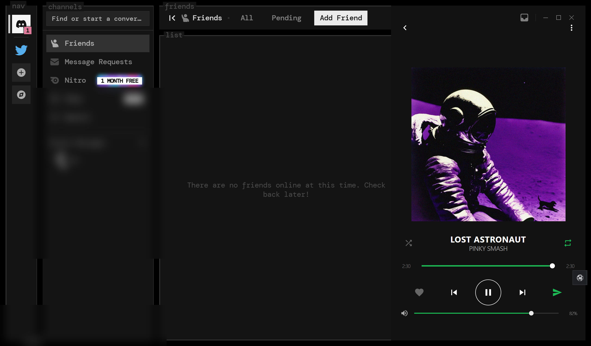
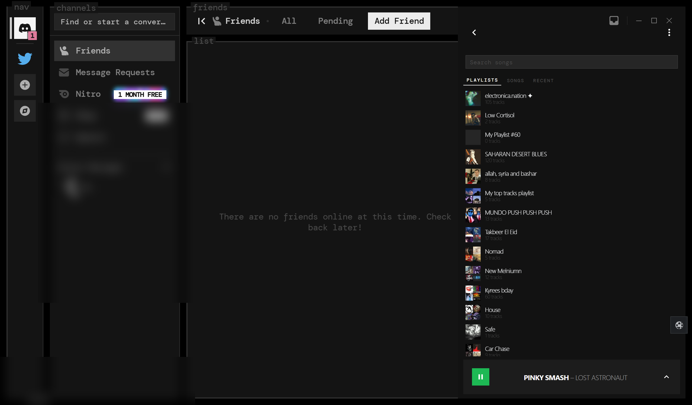
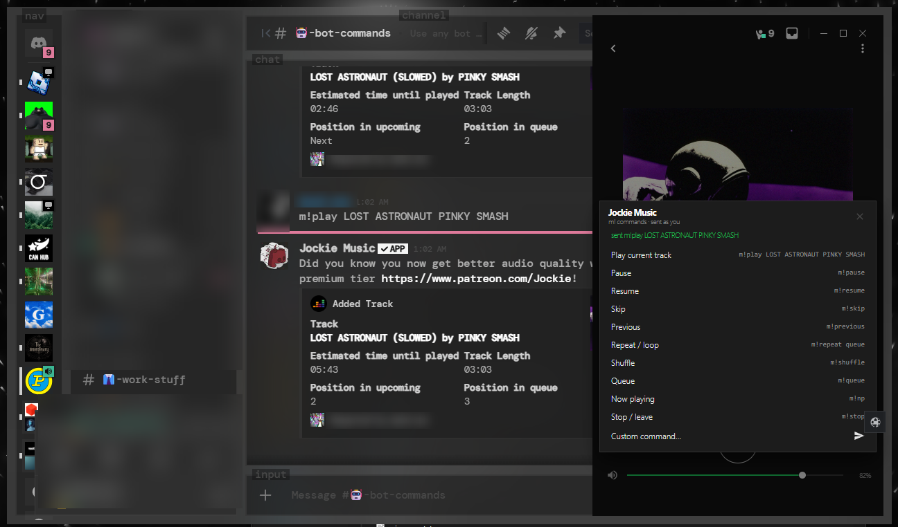

# SpotifyPanel

A docked Spotify controller for Discord, built as a
[BetterDiscord](https://betterdiscord.app/) plugin. It talks to the Spotify Web
API directly from the Discord renderer, so there is no sidecar, no bot token and
nothing to install beyond the plugin file.








## Features

- **Player panel** docked to the right edge: album art, title, artist, shuffle,
  repeat, a draggable seek rail between the elapsed and total times, like/save,
  previous/play/pause/next, and volume.
- **Live progress** interpolated locally between 5s polls, with the scrubber
  holding its position while you drag.
- **Library:** playlists, liked songs and recently played, with per-row play and
  add-to-queue.
- **Queue:** current track plus up next, jump and re-queue rows.
- **Device transfer:** click a device pill in the menu to move playback.
- **Compact bottom bar** on the library, queue and settings views, with play,
  artist - title and a chevron back to the player.
- **Discord bot bridge:** left-click Send posts `{prefix}play <query>` to a music
  channel; right-click opens a command sheet (play, pause, resume, skip,
  previous, repeat, shuffle, queue, now playing, stop, custom). Profiles for
  Jockie, JMusicBot, MusicBot and custom prefixes.
- **Panel coexistence:** registers `window.__panelRegistry.spotify` and hides the
  neighbouring panels so they never overlap.
- **Keep-alive auth:** Authorization Code + PKCE with your own free Spotify app;
  refresh tokens are stored locally and refreshes are handled in-plugin.

## Requirements

- BetterDiscord (PTB or stable) on Windows 10/11
- A Spotify account. **Playback control needs Premium**; free accounts can still
  read what is playing but the transport returns `403 PREMIUM_REQUIRED`.
- One free Spotify developer app (2 minutes, one time) so installs do not share
  a quota. No Client Secret is ever needed.

## Install

```bat
copy SpotifyPanel.plugin.js "%APPDATA%\BetterDiscord\plugins\"
```

Then enable **SpotifyPanel** in BetterDiscord settings and restart Discord (or
reload with `Ctrl+R`). Press `Alt+E` to toggle the panel.

## First-time Spotify setup

1. Open <https://developer.spotify.com/dashboard> and create an app.
2. Add the redirect URI exactly, trailing slash included:
   `http://127.0.0.1:8899/callback/`
3. Copy the app's **Client ID** (not the secret).
4. In the panel menu choose **Connect Spotify**, paste the Client ID and press
   Connect. Approve in the browser. If the loopback listener is unavailable, the
   panel asks you to paste the redirected URL from the address bar.
5. Start playback in the Spotify desktop app once so the panel has an active
   device.

Tokens live in `SpotifyPanel.config.json` under the BetterDiscord plugins folder.
They are never logged, and **Disconnect Spotify** revokes them.

## Repo layout

| Path | Purpose |
| --- | --- |
| `SpotifyPanel.plugin.js` | single-file BetterDiscord panel (UI, auth, Web API) |
| `screenshots/` | panel captures used by this README |
| `docs/` | build log, scope, music-bot and transport specs |
| `tests/SpotifyPanel.lifecycle-test.js` | headless harness (stubbed BdApi + fetch) |

## Settings

All settings are in the panel's own settings view and in BetterDiscord's plugin
settings: Client ID, refresh token, music channel ID, bot profile and command
templates, width, height, hotkey and default volume.

## Tests

```bat
node tests\SpotifyPanel.lifecycle-test.js
```

The harness stubs `BdApi` and `fetch` and exercises auth, PKCE, API mapping,
music-bot commands, settings parsing and start/stop lifecycle. It must pass
offline.

## Troubleshooting

- **"not connected"** - run the Connect flow above; the refresh token may have
  been revoked after a password change.
- **"premium required for control"** - Spotify only allows transport changes on
  Premium accounts.
- **"no active device"** - open Spotify on a device and press play once.
- **Panel does not appear** - only `*.plugin.js` files load from the BD plugins
  folder; toggle the plugin off and on, or reload Discord.
- **Port 8899 busy** - close the other auth helper and press Connect again.

## Limitations

- Playback control depends on Spotify Premium.
- Private sessions and local files are not exposed reliably by the Web API.
- No lyrics, podcasts or video.
- Developed against Discord PTB on Windows; other builds are untested.

## Disclaimer

This project is not affiliated with Spotify, Discord or BetterDiscord. It uses
your own Spotify developer app and the public Web API; respect Spotify's terms of
service.
